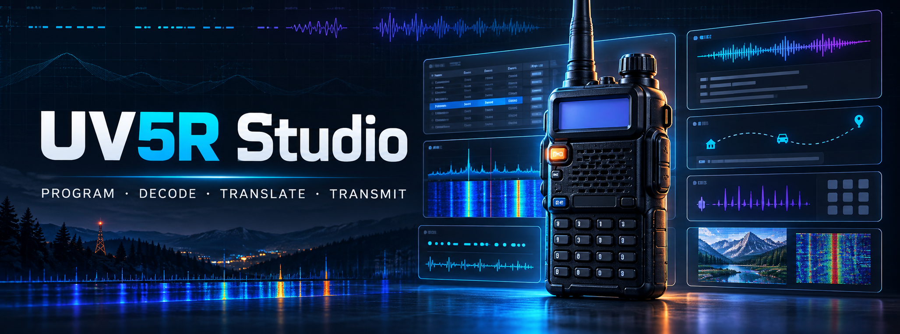

# UV5R Studio



  
<div align="center">
   
   
   
   
   
   <br/>
</div><br/>
<div align="center">
  <a href="https://github.com/VivienRg/uv5r-studio/releases/latest"></a>
  <a href="https://github.com/VivienRg/uv5r-studio/releases/latest"></a>
  <a href="https://github.com/VivienRg/uv5r-studio/releases/latest"></a>
</div>
<br/>
<br/>

> [!WARNING]
> **Windows builds use a self-signed certificate.** Windows SmartScreen may show an Unknown publisher warning because the certificate is not issued by a publicly trusted authority. Download only from this project's [official GitHub Releases](https://github.com/VivienRg/uv5r-studio/releases), verify the file, and read the [Windows installation guidance](docs/installation.md#windows) before proceeding.

**A desktop control room for the Baofeng UV-5R.** Program channels, monitor radio audio, decode common signals, translate conversations, and transmit from one app.

UV5R Studio is built with Electron and plain JavaScript. It has no frontend build step and keeps speech recognition on-device.

<div align="center">
  <strong>Share</strong><br><br>
  <a href="https://x.com/intent/tweet?hashtags=opensource%2Camateurradio&text=Check%20out%20UV5R%20Studio&url=https%3A%2F%2Fgithub.com%2FVivienRg%2Fuv5r-studio">
    
  </a>
</div>

<hr/>
<details>

## Table of Contents 📜

- [Built with](#built-with)
- [Features](#features-)
- [Requirements](#requirements)
- [Run from source](#run-from-source)
- [First use](#first-use)
- [Project structure](#project-structure)
- [Documentation](#documentation)
- [Translation and speech](#translation-and-speech)
- [Build for distribution](#build-for-distribution)
- [FAQ](#faq-)
- [Radio notes](#radio-notes)
- [Release history](#release-history)
- [Authors](#authors)
- [Licence](#licence)

</details>

## Built with

[](https://www.electronjs.org/)
[](https://developer.mozilla.org/docs/Web/JavaScript)
[](https://developer.mozilla.org/docs/Web/HTML)
[](https://developer.mozilla.org/docs/Web/CSS)
[](https://webassembly.org/)
[](https://onnxruntime.ai/)
[](https://huggingface.co/docs/transformers.js/)
[](https://www.electron.build/)

The Electron application and packaging files are all included in the repository:

| File | Purpose |
| --- | --- |
| `main.js` | Electron main process and application entry point |
| `preload.js` | Context-isolated IPC bridge exposed to the renderer |
| `src/index.html` | Renderer entry point |
| `electron-builder.yml` | macOS, Windows, and Linux packaging and signing configuration |
| `build/entitlements.mac.plist` | macOS hardened-runtime entitlements |
| `build/icon.icns` | macOS application icon |
| `build/icon.png` | Windows and Linux application icon |
| `.github/workflows/build-release.yml` | Cross-platform CI build, signing, release, and artifact upload |
| `package.json` | Electron dependencies and development/build commands |

## Features ✨

- **Radio programming** — read and write UV-5R channel memories over a USB programming cable, with automatic backups.
- **Channel management** — edit memories, import or export CHIRP CSV files, and load the included Taiwan channel plan.
- **Signal decoding** — receive voice-to-text, Morse, DTMF, APRS/AX.25 packet data, and SSTV images.
- **Conversation view** — combine decoded voice, Morse, and packet text in one thread, with optional translation.
- **Signal generation** — create voice, Morse, packet, DTMF, and SSTV audio for transmission.
- **Transmit safeguards** — the app starts in receive-only mode; transmission requires a valid code signature, licence acknowledgement, and explicit Certified mode activation.
- **Local speech recognition** — Whisper runs locally through Transformers.js and ONNX Runtime.

> [!IMPORTANT]
> You are responsible for complying with local radio regulations, licence conditions, permitted frequencies, bandwidth, power, and identification requirements. Certified mode is a guardrail, not a substitute for operator judgement.

## Requirements

- macOS for the complete feature set; Windows supports receiving and decoding, but currently needs a TTS backend for voice transmission.
- A Baofeng UV-5R and compatible USB programming cable for channel programming.
- An audio connection from the radio speaker output to the computer input for receiving and decoding.
- An audio connection from the computer output to the radio input, plus an appropriate keying setup, for transmission.
- Node.js 22.12 or newer and npm 10 or newer for development.

Many UV-5R programming cables use a CH340 or PL2303 USB chip and may require the manufacturer's driver.

## Documentation

Full user and developer documentation is available in [`docs/`](docs/README.md):

- [Installation on macOS, Windows, and Linux](docs/installation.md)
- [Development setup](docs/development.md)
- [Building releases](docs/building.md)
- [Signing and notarization](docs/signing.md)
- [Radio safety](docs/radio-safety.md)

## Run from source

```bash
npm install
npm start
```

Run the automated checks:

```bash
npm test
```

Run the end-to-end receiver self-test, which feeds generated Morse, packet, and SSTV audio through the real receive path:

```bash
npm run selftest
```

## First use

1. Connect the programming cable to the computer and radio, then turn on the radio.
2. Start UV5R Studio and open **Radio**.
3. Select **Read from radio** before making changes. The app saves a backup automatically.
4. Edit or import channels, then select **Write to radio**.
5. To decode signals, connect the radio's speaker output to the computer, open **Receive**, choose the audio input, and start the receiver.

Only channel memories and names are written to the radio; other radio menu settings are left unchanged.

## Project structure

```text
main.js                   Electron main process, app:// protocol, serial picker,
                          keychain API key, translation, macOS TTS, signature check
preload.js                IPC bridge exposed as window.api
src/index.html            Application shell
src/styles.css            Interface styles
src/app.js                Channels, radio I/O, receiver, scan, DTMF, and log
src/features.js           Conversation, Morse, images, settings, Certified mode,
                          and the transmit engine
src/uv5r.js               UV-5R memory codec, clone protocol, and CHIRP CSV support
src/dsp.js                Resampling, DTMF, AFSK1200, AX.25, and APRS DSP
src/cw.js                 Morse encoder and adaptive decoder
src/sstv.js               Robot 36, Martin M1, Scottie S1, and PD 120 SSTV
src/speech-worker.js      Whisper speech-to-text worker
src/channels-default.js   Taiwan, emergency, and international channel plan
src/vendor/               Transformers.js and ONNX Runtime WASM
build/                    App icons and macOS entitlements
test/                     Unit tests and simulated radio
dev/                      Self-tests and vendor update tooling; not shipped
```

See [`THIRD_PARTY_NOTICES.md`](THIRD_PARTY_NOTICES.md) for bundled dependency notices.

## Translation and speech

Translation uses the Anthropic Messages API with the operator's own API key. The key is stored with Electron `safeStorage`, and the model can be changed in Settings. Speech recognition runs locally; spoken output uses the macOS `say` command.

To update the vendored speech engine:

```bash
TRANSFORMERS_VERSION=3.8.1 npm run vendor
```

## Build for distribution

### GitHub Actions

The [`build-release.yml`](.github/workflows/build-release.yml) workflow tests the project and builds macOS, Windows, and Linux releases using [`electron-builder.yml`](electron-builder.yml). macOS artifacts are signed and notarized, the Windows installer is self-signed, and Linux is published as AppImage and Debian packages. It runs only for pushes to the `release` branch and version tags matching `v*.*.*`. A tag build must exactly match the version in `package.json`—for example, version `1.1.0` requires tag `v1.1.0`—and the tagged commit must belong to the `release` branch. Successful tag builds are attached to a GitHub Release.

Configure these repository secrets under **Settings → Secrets and variables → Actions**:

| Secret | Value |
| --- | --- |
| `APPLE_TEAM_ID` | Apple Developer Team ID |
| `APPLE_API_KEY` | Base64-encoded contents of the App Store Connect `.p8` file |
| `APPLE_API_KEY_ID` | App Store Connect API Key ID |
| `APPLE_API_ISSUER` | App Store Connect Issuer ID |
| `APPLE_ID` | Apple ID stored only as an encrypted repository secret |
| `APPLE_APP_SPECIFIC_PASSWORD` | App-specific password created at account.apple.com |
| `MAC_CSC_LINK` | Base64-encoded Developer ID Application `.p12` certificate |
| `MAC_CSC_KEY_PASSWORD` | Password used when exporting the `.p12` certificate |
| `WIN_CSC_LINK` | Base64-encoded self-signed Windows `.pfx` certificate |
| `WIN_CSC_KEY_PASSWORD` | Password protecting the Windows `.pfx` certificate |

Also create the repository variable `APP_BUNDLE_ID` with the value `com.uv5r-studio.app`. The workflow passes it explicitly to electron-builder. The same value is the default `appId` in `electron-builder.yml`.

Add the `.p8` file directly from your machine with the GitHub CLI:

```bash
base64 < /absolute/path/to/AuthKey_XXXXXXXXXX.p8 | tr -d '\n' | gh secret set APPLE_API_KEY
gh secret set APPLE_API_KEY_ID
gh secret set APPLE_API_ISSUER
gh secret set APPLE_TEAM_ID
gh secret set APPLE_ID
gh secret set APPLE_APP_SPECIFIC_PASSWORD
gh variable set APP_BUNDLE_ID --body 'com.uv5r-studio.app'
```

Commands without piped values prompt securely for their values. Export the **Developer ID Application** certificate and its private key from Keychain Access as a password-protected `.p12`, then add it in the same way:

```bash
base64 < /absolute/path/to/DeveloperIDApplication.p12 | tr -d '\n' | gh secret set MAC_CSC_LINK
gh secret set MAC_CSC_KEY_PASSWORD
```

The workflow passes the encoded `.p8` value directly to electron-builder, which supports base64-encoded API keys in CI. Neither private file is written to the repository. Secrets are deliberately not used in pull-request workflows, where secrets from forked repositories are unavailable.

### macOS signing and notarization

1. In the Apple Developer account, create a **Developer ID Application** certificate and install it in the login keychain. Confirm that it is available:

   ```bash
   security find-identity -v -p codesigning
   ```

2. In App Store Connect, create an API key under **Users and Access → Integrations → Keys**, then download the `.p8` file. Keep it in a secure location outside the repository. For local builds, use its path as shown below; for GitHub Actions, store its base64-encoded contents in the `APPLE_API_KEY` repository secret as described above.
3. Copy `.env.example` to `.env` and configure the four required values:

   ```dotenv
   APP_BUNDLE_ID=com.uv5r-studio.app
   APPLE_TEAM_ID=XXXXXXXXXX
   APPLE_API_KEY=/absolute/path/to/AuthKey_XXXXXXXXXX.p8
   APPLE_API_KEY_ID=XXXXXXXXXX
   APPLE_API_ISSUER=xxxxxxxx-xxxx-xxxx-xxxx-xxxxxxxxxxxx
   APPLE_ID=jon.wick@yours.com
   APPLE_APP_SPECIFIC_PASSWORD=xxxx-xxxx-xxxx-xxxx
   ```

   `APPLE_API_KEY` is the absolute filesystem path to your downloaded `.p8` file, not the key's text. `APPLE_API_KEY_ID` is the 10-character Key ID shown in App Store Connect, `APPLE_API_ISSUER` is the Issuer ID, and `APPLE_TEAM_ID` is your Apple Developer Team ID. `APPLE_ID` and `APPLE_APP_SPECIFIC_PASSWORD` provide the fallback Apple ID authentication method; when the API-key variables are present, electron-builder uses API-key authentication.
4. Build, sign, notarize, and staple the arm64 and x64 releases:

   ```bash
   set -a; source .env; set +a
   npm run dist:mac
   ```

   Artifacts are written to `release/`.

5. Verify the signed application and disk image:

   ```bash
   codesign --verify --deep --strict --verbose=2 "release/mac-arm64/UV5R Studio.app"
   spctl -a -vvv -t install "release/mac-arm64/UV5R Studio.app"
   xcrun stapler validate "release/UV5R Studio-1.1.0-arm64.dmg"
   ```

The application ID is `com.uv5r-studio.app`. Keep `appId` in `electron-builder.yml`, the `APP_BUNDLE_ID` repository variable, keychain entries, and macOS privacy permissions aligned if it changes.

The electron-builder configuration also defines the app's product name, author, copyright, macOS Utilities category, icon, artifact naming, hardened-runtime entitlements, notarization requirement, and Finder-visible bundle metadata.

### Certified mode and code signing

At startup, `main.js` runs `codesign --verify --deep --strict` against the application bundle. Settings displays the signer, and Certified mode remains locked if signature verification fails. To require a specific Developer ID team, set `REQUIRED_TEAM_ID` in the signature section of `main.js`.

### macOS entitlements

| Entitlement | Purpose |
| --- | --- |
| `com.apple.security.cs.allow-jit` | V8 and WebAssembly under the hardened runtime |
| `com.apple.security.cs.allow-unsigned-executable-memory` | WebAssembly speech engine |
| `com.apple.security.device.audio-input` | Radio audio input and push-to-talk microphone |
| `com.apple.security.device.usb` | USB programming cable |

The application is not sandboxed, so the current configuration is intended for Developer ID distribution rather than the Mac App Store.

## FAQ 🤔

### What is UV5R Studio?

UV5R Studio is a desktop application for programming, monitoring, decoding, and—with the appropriate licence and hardware—transmitting through a Baofeng UV-5R. It brings channel editing, voice-to-text, Morse, DTMF, APRS/packet, SSTV, and translated conversations into one interface.

### How do I get started?

Follow [Run from source](#run-from-source) to install the dependencies and launch the app, then use the [First use](#first-use) steps to connect and read your radio safely.

### Does it support macOS, Windows, and Linux?

macOS provides the complete feature set. Windows and Linux support programming, receiving, and decoding; voice transmission currently needs a platform-compatible TTS backend. Mobile platforms are not supported.

### Does the app transmit automatically?

No. UV5R Studio starts in receive-only mode. Transmission requires a valid signed build, an amateur-radio licence acknowledgement, and explicit Certified mode activation. The operator remains responsible for complying with local regulations.

### Is speech recognition sent to a cloud service?

No. Whisper speech recognition runs locally through Transformers.js and ONNX Runtime. Optional translation uses the Anthropic API with the operator's own API key.

### How can I contribute?

Read the [Contributing Guidelines](CONTRIBUTING.md), choose or open an issue, create a focused branch, and submit a pull request targeting `release`. Automated checks must pass before maintainer review and merging.

### How do I report a bug or request a feature?

Open a [GitHub issue](https://github.com/VivienRg/uv5r-studio/issues/new/choose) and select the bug-report or feature-request template. Remove credentials, private recordings, and personal information before attaching logs.

### How can I contact the maintainers?

Open a [GitHub issue](https://github.com/VivienRg/uv5r-studio/issues) or contact [@vivienroggero on X](https://x.com/vivienroggero).

## Radio notes

- The UV-5R does not provide CAT control. Scanning happens on the radio; UV5R Studio records scan stops.
- Always read the radio before writing so that you have a known-good backup.
- Confirm that each channel is legal for your licence and location before enabling transmission.

## Release history

Release tags follow the version in `package.json` using the `vMAJOR.MINOR.PATCH` format. Signed and notarized artifacts are produced automatically when a matching version tag points to a commit on the `release` branch.

- **1.1.0** — Current development release: radio programming, channel management, multi-mode decoding, conversations, translation, SSTV, Morse, packet, DTMF, and Certified mode.

See [GitHub Releases](https://github.com/VivienRg/uv5r-studio/releases) for published downloads and release notes.

## Authors

- **Viorant Inc.** — Initial development
  - Maintainer: [Vivien Roggero](https://github.com/VivienRg)
  - X: [@vivienroggero](https://x.com/vivienroggero)

See the [contributors](https://github.com/VivienRg/uv5r-studio/graphs/contributors) who have participated in the project.

## Licence

UV5R Studio is available under the [MIT License](LICENSE). You may use, copy, modify, and distribute the application and its source code under the licence terms.

Contributions are welcome. Read [CONTRIBUTING.md](CONTRIBUTING.md), open a structured bug report or feature request, and submit changes through a pull request. Pull requests targeting `release` are automatically tested and packaged before maintainer review.

Maintainers must require the `Test and package` status check in the GitHub ruleset for the `release` branch to prevent merging a pull request that has not passed validation.
